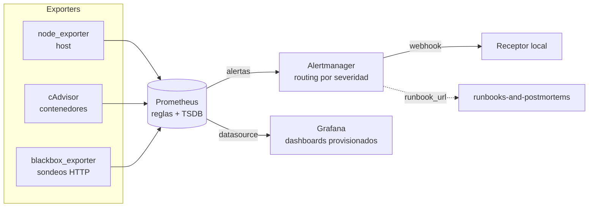

# monitoring-as-code

[](https://github.com/dgr-devops/monitoring-as-code/actions/workflows/ci.yml)


Stack de monitorización **100 % como código**: Prometheus, Alertmanager, Grafana, node_exporter, cAdvisor y blackbox_exporter,
con reglas de alerta probadas con tests unitarios, dashboards provisionados automáticamente y runbooks enlazados en cada alerta.
Se levanta con un solo comando y todo cambio pasa por Git + CI.

## Arquitectura



## Contenido

| Ruta | Qué hay |
|---|---|
| `docker-compose.yml` | Los 7 servicios, versiones fijadas, puertos solo en `127.0.0.1` |
| `prometheus/prometheus.yml` | Scrape configs + conexión con Alertmanager |
| `prometheus/rules/*.yml` | 8 reglas (host, contenedores, endpoints) con `severity`, `description` y `runbook_url` |
| `prometheus/tests/*.yml` | Tests unitarios (`promtool test rules`) |
| `alertmanager/alertmanager.yml` | Rutas por severidad, inhibición y receptores webhook |
| `grafana/provisioning/` | Datasource y proveedor de dashboards |
| `grafana/dashboards/*.json` | Node overview, Containers (cAdvisor), Alerts & targets |
| `scripts/validate.sh` | Validación completa (la usan `make validate` y el CI) |
| `docs/alertas.md` · `docs/decisiones.md` | Qué hace cada alerta y por qué se diseñó así |
| `docs/evidencias/` | Salidas reales capturadas al verificar el stack |

## Uso

Requisitos: Docker con Compose v2 (y `make`, opcional).

```bash
make up          # levanta el stack
make status      # targets y alertas activas
make validate    # promtool + amtool + JSON + tests de reglas
make logs        # notificaciones que recibe el webhook
make down
```

| Servicio | URL |
|---|---|
| Grafana (`admin`/`admin` por defecto, ver `.env.example`) | http://localhost:3000 |
| Prometheus | http://localhost:9090 |
| Alertmanager | http://localhost:9093 |

Los puertos y la contraseña se cambian copiando `.env.example` a `.env`.

## Alertas

| Alerta | Severidad | Condición |
|---|---|---|
| InstanceDown | critical | target sin responder 1 min |
| HighCpuUsage | warning | CPU > 85 % durante 10 min |
| DiskWillFillIn24h | warning | `predict_linear` proyecta disco lleno en < 24 h |
| DiskSpaceCritical | critical | < 10 % libre durante 5 min |
| MemoryPressure | warning | < 10 % de RAM disponible durante 5 min |
| ContainerRestartingFrequently | warning | > 2 reinicios en 15 min |
| EndpointDown | critical | sondeo HTTP fallando 2 min |
| Watchdog | none | siempre activa (comprueba la cadena de alertado) |

Detalle, umbrales y qué hacer en cada caso: [docs/alertas.md](docs/alertas.md).

## Verificación realizada

Todo lo siguiente se ejecutó de verdad en esta máquina (Docker 29, Compose 5.8); las salidas completas están en [docs/evidencias/](docs/evidencias/).

**1. Validación estática** (`./scripts/validate.sh`):

```text
promtool check config  -> SUCCESS: 3 rule files found / prometheus.yml is valid
promtool check rules   -> containers.yml 1 rule, endpoints.yml 2, host.yml 5 (SUCCESS)
promtool test rules    -> SUCCESS (2 ficheros de test)
amtool check-config    -> SUCCESS (1 inhibit rule, 4 receivers)
blackbox_exporter      -> Config file is ok
dashboards JSON        -> OK x3 (alerts-overview 6 paneles, containers 6, node-overview 7)
```

**2. Stack levantado**: targets en la API de Prometheus y dashboards en la API de Grafana ([01-estado.txt](docs/evidencias/01-estado.txt)):

```text
alertmanager    alertmanager:9093                   up
blackbox-http   http://grafana:3000/api/health      up
blackbox-http   http://prometheus:9090/-/healthy    up
cadvisor        cadvisor:8080                       up
node            node-exporter:9100                  up
prometheus      prometheus:9090                     up

alerts-overview | Alerts & targets       | Monitoring
containers      | Containers (cAdvisor)  | Monitoring
node-overview   | Node overview          | Monitoring
```

**3. Alerta provocada de verdad**: `docker compose stop cadvisor` → a los ~1 min Prometheus la pone en `firing`, Alertmanager la recibe con su `runbook_url` y el webhook la registra; al arrancar de nuevo, llega `resolved` ([02](docs/evidencias/02-provocar-fallo.txt), [03](docs/evidencias/03-recuperacion.txt)):

```text
InstanceDown critical cadvisor:8080 active
  runbook_url: https://github.com/dgr-devops/runbooks-and-postmortems/blob/main/runbooks/servicio-caido.md
[webhook/critical] status=firing   alertname=InstanceDown severity=critical instance=cadvisor:8080
[webhook/critical] status=resolved alertname=InstanceDown severity=critical instance=cadvisor:8080
```

**4. Los tests detectan regresiones**: cambiando un umbral (`< 0.10` → `< 0.01`) `promtool test rules` falla ([04](docs/evidencias/04-test-detecta-regresion.txt)); se revirtió después.

**5. CI en GitHub Actions**: valida (job `validate`) y levanta el stack comprobando targets, reglas y dashboards (job `stack`).

### No verificado / limitaciones

- Solo se probó en un host (Linux x86_64, Docker 29); cAdvisor puede necesitar ajustes en otros runtimes (rootless, Docker Desktop).
- La notificación real a Slack/email/PagerDuty no se probó: el receptor es un webhook local de laboratorio.
- El resto de alertas (CPU, disco, memoria, reinicios, endpoint) están verificadas con tests unitarios, pero solo `InstanceDown` se provocó en vivo.
- Sin autenticación ni TLS: pensado para laboratorio en `localhost`.

## Licencia

MIT — ver [LICENSE](LICENSE).
